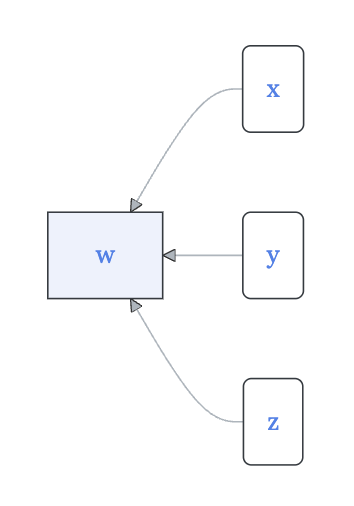

<!--
id: "pony-meet-window"
created: "Sun Oct 19 08:38:08 2025"
attribution: DTK
status: ready-to-use
chapter: 6
mode: drill
-->




::: {#exr-pony-meet-window}

<!--  -->

```{mermaid}
graph RL
  A(x)
  B(y)
  C[w]
  D(z)
  A --> C
  B --> C
  D --> C
  
classDef exogenous fill:#fff,stroke-width:1px

class A exogenous
class B exogenous
class D exogenous
```

In the above diagram ...

1. Which quantities are endogenous?

```{devoirs_choices}
#| label: choices_dddd
- 'w':
    correct: true
    feedback: 'Correct! It''s in a sharp-cornered box.'
- 'x':
    correct: false
    feedback: 'Sorry. A round-cornered box indicates an exogenous quantity.'
- 'y':
    correct: false
    feedback: 'Sorry. A round-cornered box indicates an exogenous quantity.'
- 'z':
    correct: false
    feedback: 'Sorry. A round-cornered box indicates an exogenous quantity.'
- 'None of them.':
    correct: false
```

```{r echo=FALSE}
Q <- devoirs_selection(
  label = "dddd",
  question = "Placeholder for now",
  answers = choices_dddd,
  multiple = FALSE
)
Q(inline = TRUE)
```

2. How many functions are indicated by the diagram?

```{devoirs_choices}
#| label: choices_dddd.2
- '0':
    correct: false
- '1':
    correct: true
    feedback: 'Right! There''s only one sharp-cornered box.'
- '2':
    correct: false
- '3':
    correct: false
- '4':
    correct: false
```

```{r echo=FALSE}
Q <- devoirs_selection(
  label = "dddd-2",
  question = "Placeholder for now",
  answers = choices_dddd.2,
  multiple = FALSE
)
Q(inline = TRUE)
```

3. Which quantity is the output of a function?

```{devoirs_choices}
#| label: choices_dddd.3
- 'w':
    correct: true
    feedback: 'Good! The square box stands for a function with the inputs being indicated by the inward-pointing arrows.'
- 'x':
    correct: false
- 'y':
    correct: false
- 'z':
    correct: false
- 'None of them.':
    correct: false
```

```{r echo=FALSE}
Q <- devoirs_selection(
  label = "dddd-3",
  question = "Placeholder for now",
  answers = choices_dddd.3,
  multiple = FALSE
)
Q(inline = TRUE)
```
:::
 <!-- end of exr-pony-meet-window -->
