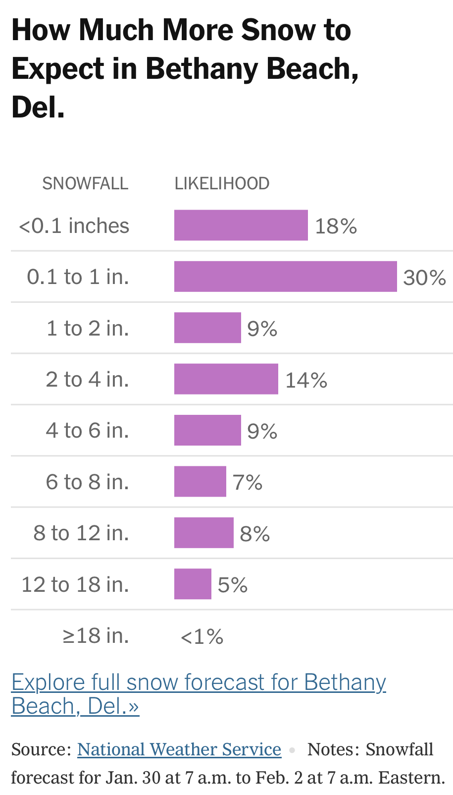

<!--
id: "cat-run-screen"
created: "Thu Feb 19 16:49:07 2026"
attribution: TBA
status: "draft"
chapter: 11
mode: exercise
-->



::: {#exr-cat-run-screen}
Here's a weather forecast in the midst of a snowy period. 



Due to round-off, the "likelihoods" do not add exactly to 1.00. But close enough, so let's treat them as probabilities. 

1. What's the probability of $\leq 1$ in of snowfall?

```{devoirs_choices}
#| label: choices_crs.1.sno
- '18%':
    correct: false
- '30%':
    correct: false
- '48%':
    correct: true
- 'Not enough info.':
    correct: false
```

```{r echo=FALSE}
Q <- devoirs_selection(
  label = "crs-1-sno",
  question = "Placeholder for now",
  answers = choices_crs.1.sno,
  multiple = FALSE
)
Q(inline = TRUE)
```

2. What's the probability of $1 \leq\ \text{snowfall} \ \leq 6$ in of snowfall?

```{devoirs_choices}
#| label: choices_crs.2.srto
- '23%':
    correct: false
- '32%':
    correct: true
- '47%':
    correct: false
- 'Not enough info.':
    correct: false
```

```{r echo=FALSE}
Q <- devoirs_selection(
  label = "crs-2-srto",
  question = "Placeholder for now",
  answers = choices_crs.2.srto,
  multiple = FALSE
)
Q(inline = TRUE)
```

3. What's the probability of $1 \leq\ \text{snowfall} \ \leq 3$ in of snowfall?

```{devoirs_choices}
#| label: choices_crs.3.wql
- '16%':
    correct: false
    feedback: 'Not what I was looking for, but pretty clever. I''m thinking you divided the 14 percent for 2 to 4 inches into 7 percent for 2 to 3 inches. Very reasonable.'
- '32%':
    correct: false
- '48%':
    correct: false
- 'Not enough info.':
    correct: true
```

```{r echo=FALSE}
Q <- devoirs_selection(
  label = "crs-3-wql",
  question = "Placeholder for now",
  answers = choices_crs.3.wql,
  multiple = FALSE
)
Q(inline = TRUE)
```


:::
 <!-- end of exr-cat-run-screen -->
