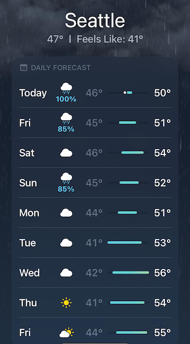

<!--
id: "nephew-find-drawer"
created: "Thu Feb 19 09:59:42 2026"
attribution: TBA
status: ready-to-use
chapter: 11
mode: exercise
-->



::: {#exr-nephew-find-drawer}
Here is the weather forecast for a winter week in Seattle, Washington. The blue numbers, as you may well know, are the probabilities of rain for that day.



1. What are the odds of rain on Sunday?

```{devoirs_choices}
#| label: choices_nfd.1.ekxs
- '0':
    correct: false
- '0.1764':
    correct: false
- '5.67':
    correct: true
    feedback: 'Yes! That is, 85/15'
- '$\infty$':
    correct: false
- 'Not enough information given.':
    correct: false
```

```{r echo=FALSE}
Q <- devoirs_selection(
  label = "nfd-1-ekxs",
  question = "Placeholder for now",
  answers = choices_nfd.1.ekxs,
  multiple = FALSE
)
Q(inline = FALSE)
```

2. What are the odds of rain on Monday?

```{devoirs_choices}
#| label: choices_nfd.2.uew
- '0':
    correct: true
- '0.1764':
    correct: false
- '5.67':
    correct: false
- '$\infty$':
    correct: false
- 'Not enough information given.':
    correct: false
```

```{r echo=FALSE}
Q <- devoirs_selection(
  label = "nfd-2-uew",
  question = "Placeholder for now",
  answers = choices_nfd.2.uew,
  multiple = FALSE
)
Q(inline = FALSE)
```


3. What are the odds of rain for the first day of the forecast, labelled "Today."

```{devoirs_choices}
#| label: choices_nfd.3.aur
- '0':
    correct: false
- '0.1764':
    correct: false
- '5.67':
    correct: false
- '$\infty$':
    correct: true
- 'Not enough information given.':
    correct: false
```

```{r echo=FALSE}
Q <- devoirs_selection(
  label = "nfd-3-aur",
  question = "Placeholder for now",
  answers = choices_nfd.3.aur,
  multiple = FALSE
)
Q(inline = FALSE)
```

:::
 <!-- end of exr-nephew-find-drawer -->
