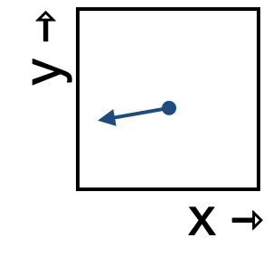

<!--
id: "beech-sleep-canoe"
created: "Fri Feb 20 07:43:32 2026"
attribution: TBA
status: ready-to-use
chapter: 13
mode: exercise
-->



::: {#exr-beech-sleep-canoe}


1. Which of these best describes the change in the x-component of the state as it moves through this region of state space?

```{devoirs_choices}
#| label: choices_flow.bsc.1.83
- 'decreasing quickly':
    correct: true
- 'decreasing slowly':
    correct: false
- 'not changing':
    correct: false
- 'increasing slowly':
    correct: false
- 'increasing quickly':
    correct: false
```

```{r echo=FALSE}
Q <- devoirs_selection(
  label = "flow-bsc-1-83",
  question = "Placeholder for now",
  answers = choices_flow.bsc.1.83,
  multiple = FALSE
)
Q(inline = TRUE)
```

2. Which of these best describes the change in the y-component of the state as it moves through this region of state space?

```{devoirs_choices}
#| label: choices_flow.bsc.2.p2
- 'decreasing quickly':
    correct: false
- 'decreasing slowly':
    correct: true
- 'not changing':
    correct: false
- 'increasing slowly':
    correct: false
- 'increasing quickly':
    correct: false
```

```{r echo=FALSE}
Q <- devoirs_selection(
  label = "flow-bsc-2-p2",
  question = "Placeholder for now",
  answers = choices_flow.bsc.2.p2,
  multiple = FALSE
)
Q(inline = TRUE)
```

:::
 <!-- end of exr-beech-sleep-canoe -->
