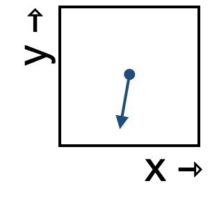

<!--
id: "cheetah-ring-clock"
created: "Fri Feb 20 07:38:40 2026"
attribution: TBA
status: "draft"
chapter: 1
mode: exercise
-->



::: {#exr-cheetah-ring-clock}


1. Which of these best describes the change in the x-component of the state as it moves through this region of state space?

```{devoirs_choices}
#| label: choices_flow.crc.1.3k
- 'decreasing quickly':
    correct: false
- 'decreasing slowly':
    correct: true
- 'not changing':
    correct: false
- 'increasing slowly':
    correct: false
- 'increasing quickly':
    correct: false
```

```{r echo=FALSE}
Q <- devoirs_selection(
  label = "flow-crc-1-3k",
  question = "Placeholder for now",
  answers = choices_flow.crc.1.3k,
  multiple = FALSE
)
Q(inline = TRUE)
```

2. Which of these best describes the change in the y-component of the state as it moves through this region of state space?

```{devoirs_choices}
#| label: choices_flow.crc.2.kus
- 'decreasing quickly':
    correct: true
- 'decreasing slowly':
    correct: false
- 'not changing':
    correct: false
- 'increasing slowly':
    correct: false
- 'increasing quickly':
    correct: false
```

```{r echo=FALSE}
Q <- devoirs_selection(
  label = "flow-crc-2-kus",
  question = "Placeholder for now",
  answers = choices_flow.crc.2.kus,
  multiple = FALSE
)
Q(inline = TRUE)
```

:::
 <!-- end of exr-cheetah-ring-clock -->
