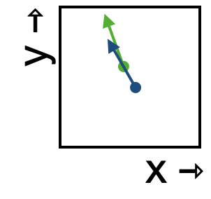

<!--
id: "cow-sharpen-linen"
created: "Fri Feb 20 07:56:17 2026"
attribution: DTK
status: ready-to-use
chapter: 13
mode: exercise
-->



::: {#exr-cow-sharpen-linen}


1. Which starting point---green or blue---will bring the state to the other flow arrow?

```{devoirs_choices}
#| label: choices_flow.csl.1.lw
- 'green':
    correct: false
    feedback: 'Sorry, but starting at the green point the flow carries the state away from blue.'
- 'blue':
    correct: true
```

```{r echo=FALSE}
Q <- devoirs_selection(
  label = "flow-csl-1-lw",
  question = "Placeholder for now",
  answers = choices_flow.csl.1.lw,
  multiple = FALSE
)
Q(inline = TRUE)
```

2. Following the flow through this small region of space, which of the following best describes the shape of the trajectory?

```{devoirs_choices}
#| label: choices_flow.csl.2.lw
- 'straight':
    correct: false
- 'curved clockwise':
    correct: true
- 'curved counterclockwise':
    correct: false
```

```{r echo=FALSE}
Q <- devoirs_selection(
  label = "flow-csl-2-lw",
  question = "Placeholder for now",
  answers = choices_flow.csl.2.lw,
  multiple = FALSE
)
Q(inline = TRUE)
```

:::
 <!-- end of exr-cow-sharpen-linen -->
