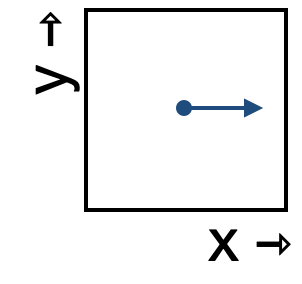

<!--
id: "gator-walk-piano"
created: "Fri Feb 20 07:41:15 2026"
attribution: TBA
status: ready-to-use
chapter: 13
mode: exercise
-->



::: {#exr-gator-walk-piano}

1. Which of these best describes the change in the x-component of the state as it moves through this region of state space?

```{devoirs_choices}
#| label: choices_flow.gwp.1.8e
- 'decreasing':
    correct: false
- 'not changing':
    correct: false
- 'increasing':
    correct: true
```

```{r echo=FALSE}
Q <- devoirs_selection(
  label = "flow-gwp-1-8e",
  question = "Placeholder for now",
  answers = choices_flow.gwp.1.8e,
  multiple = FALSE
)
Q(inline = TRUE)
```

2. Which of these best describes the change in the y-component of the state as it moves through this region of state space?

```{devoirs_choices}
#| label: choices_flow.gwp.2.kus
- 'decreasing':
    correct: false
- 'not changing':
    correct: true
- 'increasing':
    correct: false
```

```{r echo=FALSE}
Q <- devoirs_selection(
  label = "flow-gwp-2-kus",
  question = "Placeholder for now",
  answers = choices_flow.gwp.2.kus,
  multiple = FALSE
)
Q(inline = TRUE)
```

:::
 <!-- end of exr-gator-walk-piano -->
