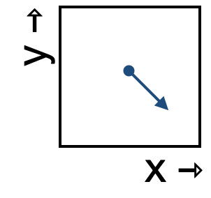

<!--
id: "lamb-rise-kitchen"
created: "Fri Feb 20 07:51:13 2026"
attribution: DTK
status: ready-to-use
chapter: 13
mode: exercise
-->



::: {#exr-lamb-rise-kitchen}


1. Which of these best describes the change in the x-component of the state as it moves through this region of state space?

```{devoirs_choices}
#| label: choices_flow.lrk.1.82s
- 'decreasing':
    correct: false
- 'not changing':
    correct: false
- 'increasing':
    correct: true
```

```{r echo=FALSE}
Q <- devoirs_selection(
  label = "flow-lrk-1-82s",
  question = "Placeholder for now",
  answers = choices_flow.lrk.1.82s,
  multiple = FALSE
)
Q(inline = TRUE)
```

2. Which of these best describes the change in the y-component of the state as it moves through this region of state space?

```{devoirs_choices}
#| label: choices_flow.lrk.2.982
- 'decreasing':
    correct: true
- 'not changing':
    correct: false
- 'increasing':
    correct: false
```

```{r echo=FALSE}
Q <- devoirs_selection(
  label = "flow-lrk-2-982",
  question = "Placeholder for now",
  answers = choices_flow.lrk.2.982,
  multiple = FALSE
)
Q(inline = TRUE)
```

3. Notice that the previous questions didn't offer choices like "decreasing slowly" or "increasing quickly." That's for a good reason. What is it?

```{devoirs_choices}
#| label: choices_flow.lrk.3.u3s
- 'There is only one flow arrow.':
    correct: false
- '"slowly" and "quickly" are relative. Here, the rate of change has about the same magnitude in both the x and y directions.':
    correct: true
- 'The flow is toward the south-east rather than the south-west.':
    correct: false
```

```{r echo=FALSE}
Q <- devoirs_selection(
  label = "flow-lrk-3-u3s",
  question = "Placeholder for now",
  answers = choices_flow.lrk.3.u3s,
  multiple = FALSE
)
Q(inline = FALSE)
```

:::
 <!-- end of exr-lamb-rise-kitchen -->
