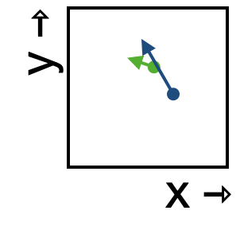

<!--
id: "nephew-do-screen"
created: "Fri Feb 20 07:32:40 2026"
attribution: DTK
use: Drill dynamics
status: ready-to-use
chapter: 13
mode: exercise
-->



::: {#exr-nephew-do-screen}



1. Following the flow through this small region of space, which of the following best describes the shape of the trajectory?

```{devoirs_choices}
#| label: choices_flow.nds.1.jw
- 'straight':
    correct: false
- 'curved clockwise':
    correct: false
- 'curved counterclockwise':
    correct: true
```

```{r echo=FALSE}
Q <- devoirs_selection(
  label = "flow-nds-1-jw",
  question = "Placeholder for now",
  answers = choices_flow.nds.1.jw,
  multiple = FALSE
)
Q(inline = TRUE)
```

2. Which of the following best describes the speed of movement through the state-space region?

```{devoirs_choices}
#| label: choices_flow.nds.2.xls
- 'steady speed':
    correct: false
- 'speeding up':
    correct: false
- 'slowing down':
    correct: true
- 'not enough information':
    correct: false
- 'blue':
    correct: true
```

```{r echo=FALSE}
Q <- devoirs_selection(
  label = "flow-nds-2-xls",
  question = "Placeholder for now",
  answers = choices_flow.nds.2.xls,
  multiple = TRUE
)
Q(inline = TRUE)
```

:::
 <!-- end of exr-nephew-do-screen -->
