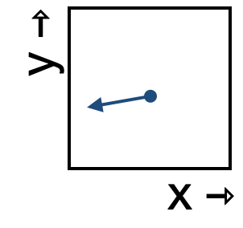

<!--
id: "oak-ring-socks"
created: "Fri Feb 20 07:54:55 2026"
attribution: TBA
status: ready-to-use
chapter: 13
mode: exercise
-->



::: {#exr-oak-ring-socks}


Which of these best describes how fast the state will move through this section of space?

```{devoirs_choices}
#| label: choices_flow.ors.1.sy
- 'The state moves slowly.':
    correct: false
- 'The state moves quickly.':
    correct: false
- 'No way to say.':
    correct: true
    feedback: 'Right! It is only by comparison that we can say one arrow is "fast" and another "slow".'
```

```{r echo=FALSE}
Q <- devoirs_selection(
  label = "flow-ors-1-sy",
  question = "Placeholder for now",
  answers = choices_flow.ors.1.sy,
  multiple = FALSE
)
Q(inline = FALSE)
```

:::
 <!-- end of exr-oak-ring-socks -->
